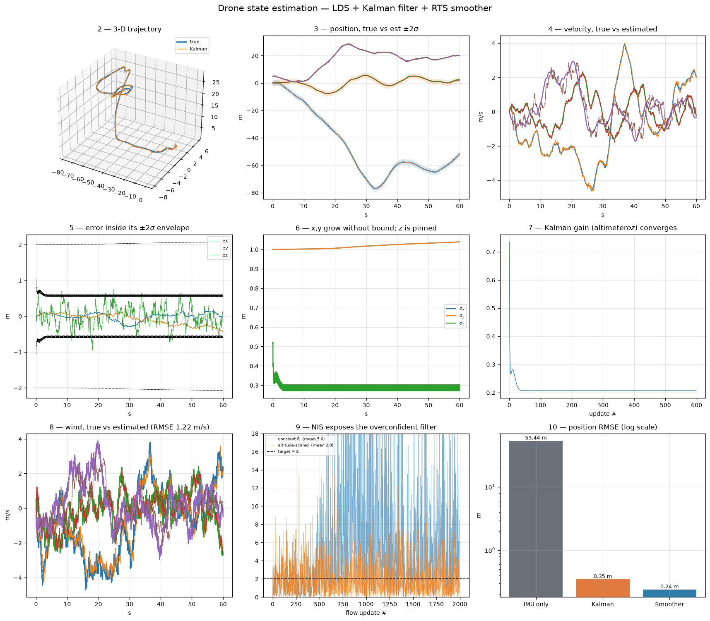
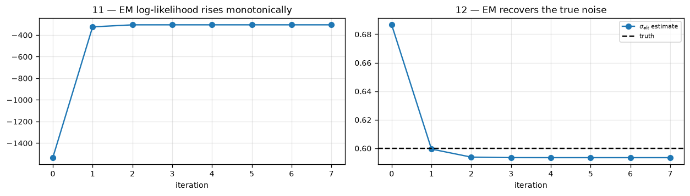

# Drone 3-D State Estimation in Turbulent Wind

**Linear Dynamical Systems + Kalman Filtering** — Machine Learning, Unit 4 (Sequential Data)

**Team Cash Guard** · V. Anbu Chelvan · S. Roopesh · B. Charith Reddy · Y. Rupesh Reddy

---

## The problem

Recover a drone's true 3-D **position**, **velocity** and the **wind** acting on it, from three
sensors that are each individually inadequate:

| Sensor | Rate | Measures | Weakness |
|---|---|---|---|
| IMU | 100 Hz | acceleration | integrating twice turns small bias into huge position error — **drifts 53 m in 60 s** |
| Altimeter | 10 Hz | height only | σ = 0.60 m, and says nothing about horizontal position |
| Optical flow | 30 Hz | horizontal velocity | σ = 0.12 m/s, and **degrades with altitude** |

On top of this, turbulent wind pushes the aircraft around. Gusts are not white noise — they are
correlated in time, so a gust now predicts a gust a second from now.

## Why this is a Unit 4 problem

A Linear Dynamical System is an HMM whose hidden state is continuous. Everything from the
discrete case carries over:

| Concept | HMM | LDS (this project) |
|---|---|---|
| Hidden state | discrete (Rainy/Sunny) | continuous (position, velocity, wind) |
| Forward pass | α recursion | **Kalman filter** — predict then update |
| Forward–backward | γ = αβ / P(O) | **RTS smoother** |
| Underflow fix | scaling factors sₜ | log-likelihood accumulated from innovations |
| Unknown parameters | EM / Baum–Welch | **EM** with the smoother in the E-step |

Because the state is continuous and every relationship is linear with Gaussian noise, the sum over
states becomes an integral with a closed form. The posterior stays Gaussian, so a mean and a
covariance are the whole answer — we never enumerate paths.

## The model

Per axis the state is `[position, velocity, wind]`, giving a 9-D state across three axes:

```
x = [px py pz  vx vy vz  wx wy wz]ᵀ
```

```
p ← p + v·Δt
v ← v + (a − k(v − w))·Δt        drag acts on AIRSPEED (v − w), not ground speed
w ← φ·w + ε,   φ = exp(−Δt/τ)    Ornstein–Uhlenbeck gust model
```

The key design decision: most treatments dump wind into `Q` as process noise. Instead we make wind
part of what we estimate, as a first-order Gauss–Markov process. The physical insight is that
aerodynamic drag depends on velocity *relative to the air*. Crucially this is still **linear**, so
an exact Kalman filter applies and no EKF is needed.

Parameters: `k = 0.8 s⁻¹` drag · `τ = 5 s` gust correlation · `σ_gust = 1.5 m/s`.
The IMU enters as the **control input `u`**, not as a measurement.

## Real data

The notebook downloads a **real PX4 flight-controller log** at runtime and measures the IMU's true
noise and bias from it:

```
https://raw.githubusercontent.com/PX4/pyulog/main/test/sample.ulg      (BSD-3-Clause)
```

Measured, not assumed:

| Quantity | Value |
|---|---|
| Sample rate | 248 Hz over 69 s, 17 070 samples |
| Accel σ (x/y/z) | 0.293 / 0.411 / 0.162 m/s² |
| Gyro σ (mean) | ≈ 0.18 rad/s |
| Accel bias | 1.091 / −0.442 / 0.189 m/s² (real, uncorrected) |
| **σ_imu feeding Q** | **0.289 m/s²** |

Measuring sensor noise from a *static* log is standard practice — with the vehicle still,
everything the accelerometer reports beyond gravity is noise and bias. It is how Allan-variance
calibration is done.

> ### Stated plainly
> The 60-second turbulent **trajectory is simulated**. Only the **IMU noise is real**. The public
> PX4 logs are bench tests where the aircraft never moved (x, y range 0.00 m), and the ETH EuRoC
> server did not respond, so a fully real flight was not available. The altimeter and optical-flow
> streams are **derived** from the trajectory, not raw hardware.

## Real database

Everything flows through SQLite — it is in the data path, not bolted on:

```
simulator  ──writes──▶  sensor_readings  ──SQL read──▶  Kalman filter
                                                              │
     ground_truth ◀──── SQL JOIN (accuracy) ────  estimates ◀──┘
```

Six tables, 14 929 rows. The filter's **only** input is `sensor_readings`, read back out with SQL.
Accuracy is computed by a SQL `JOIN` against `ground_truth`, not in numpy.

| Table | Contents |
|---|---|
| `imu_calibration` | the real measured noise, with the URL it came from |
| `imu_raw` | 4 268 real samples straight off the aircraft |
| `ground_truth` | the true 9-D state (evaluation only) |
| `sensor_readings` | the multi-rate noisy stream — the filter's input |
| `estimates` | filtered / smoothed / dead-reckoned state + variance |
| `runs` | one row per experiment: parameters and headline metrics |

Full DDL in [`schema.sql`](schema.sql).

## Results

| Method | Position RMSE | Velocity RMSE |
|---|---|---|
| IMU only (dead reckoning) | 53.44 m | 2.380 m/s |
| **Kalman filter** (real time) | **0.346 m** | 0.458 m/s |
| **RTS smoother** (offline) | **0.238 m** | 0.146 m/s |

**155× improvement** over dead reckoning. Smoothing cuts velocity error a further 3.1×.

Wind was recovered to **1.22 m/s RMSE** though no sensor measures it — only its effect through drag.

### Per-axis position RMSE (m)

| Method | x | y | z |
|---|---|---|---|
| IMU only | 51.23 | 9.32 | 12.20 |
| Kalman filter | 0.106 | 0.124 | 0.299 |
| RTS smoother | 0.106 | 0.124 | 0.127 |

Note that **z is the worst axis**, even though it is the only one a sensor measures directly: the
altimeter's 0.60 m noise is the binding limit. x and y are inferred from velocity and do better
over 60 s — until they drift.



## Two findings RMSE cannot show you

### 1 · NIS caught a filter that was accurate but lying

Optical flow degrades with altitude, but the filter first assumed constant noise. The normalised
innovation squared (NIS) should average the measurement dimension, which is 2:

| R for optical flow | NIS (want 2) | position RMSE |
|---|---|---|
| constant (wrong) | **5.67** | 0.340 m |
| altitude-scaled | 1.95 | 0.346 m |

Accuracy barely moved — so RMSE alone would never have caught it. But the overconfident filter
reported its own uncertainty **~3× too small**, which is how an autopilot flies into something
while certain it is safe.

Consistency after the fix: NIS_alt 0.97 (target 1) · NIS_flow 1.95 (target 2) · NEES 4.15
(target 6, so still mildly conservative on the wind states).

### 2 · Horizontal position is unobservable

No sensor measures x or y, so their variance grows **without bound** — visible in the covariance,
invisible in a 60 s RMSE. A 2.5 m GPS therefore *hurts* at first and only *helps* once drift
exceeds its own noise:

| Flight | no GPS | + GPS @ 1 Hz | |
|---|---|---|---|
| 60 s | 0.346 m | 0.706 m | GPS **hurts** (+104%) |
| 120 s | 0.350 m | 0.536 m | GPS **hurts** (+53%) |
| 300 s | 0.979 m | 0.561 m | GPS helps (−43%) |
| 600 s | 1.366 m | 0.693 m | GPS helps (−49%) |

Adding a sensor is only an improvement once its noise beats your drift.

## EM — learning the noise from data alone

E-step = filter + smoother (the posterior over hidden states). M-step = set each variance to the
mean squared smoothed residual. Started deliberately **3× too high**:

| Iteration | σ_alt | log L |
|---|---|---|
| start | 1.800 | −1535 |
| 1 | 0.599 | −325 |
| 3 | 0.593 | −306 |
| *truth* | *0.600* | — |

Recovered to three decimals in three iterations, log-likelihood rising monotonically exactly as
EM guarantees.



## Running it

**Colab (recommended)** — upload [`Drone_Kalman_Unit4.ipynb`](Drone_Kalman_Unit4.ipynb) to
[colab.research.google.com](https://colab.research.google.com), then Runtime → Run all. It installs
`pyulog` and fetches the real log itself. About a minute; the 12 figures appear in section 8.

**Locally**

```bash
pip install numpy scipy matplotlib pyulog
jupyter notebook Drone_Kalman_Unit4.ipynb
```

## Files

| File | What it is |
|---|---|
| `Drone_Kalman_Unit4.ipynb` | the full pipeline, self-contained, verified end to end |
| `core.py` | LDS model, simulator, Kalman filter, RTS smoother, EM |
| `db.py` | SQLite schema and the read/write layer |
| `schema.sql` | the database DDL |
| `figures/` | generated plots |
| `run_output.txt` | console output of a full run, for reference |

## Limitations

- The trajectory is simulated; only the IMU noise is real (see *Stated plainly* above).
- Altimeter and optical-flow streams are derived from the trajectory, not raw sensors.
- NEES of 4.15 against a target of 6 means the filter stays somewhat conservative on the wind states.
- A real aircraft also needs attitude estimation, which is nonlinear and outside an LDS.

## Next steps

The real log showed a **1.09 m/s² accelerometer bias** — the obvious next move is to add bias as
extra states. Beyond that: adaptive `Q`, and a genuine flight log carrying raw barometer and
optical-flow topics.

## Contributions

| Member | Contribution |
|---|---|
| V. Anbu Chelvan | LDS model formulation, wind-augmented state, Kalman filter + RTS smoother |
| S. Roopesh | Real PX4 log retrieval, IMU noise calibration, SQLite database |
| B. Charith Reddy | NEES/NIS consistency testing, GPS crossover study, observability analysis |
| Y. Rupesh Reddy | EM noise learning, figures, slide deck |

## References

- PX4 `pyulog` sample flight log — BSD-3-Clause
- Rauch, Tung & Striebel (1965), *Maximum likelihood estimates of linear dynamic systems*
- Bar-Shalom, Li & Kirubarajan (2001), *Estimation with Applications to Tracking and Navigation* — NEES/NIS
- Bishop (2006), *Pattern Recognition and Machine Learning*, ch. 13 — sequential data, LDS, EM
